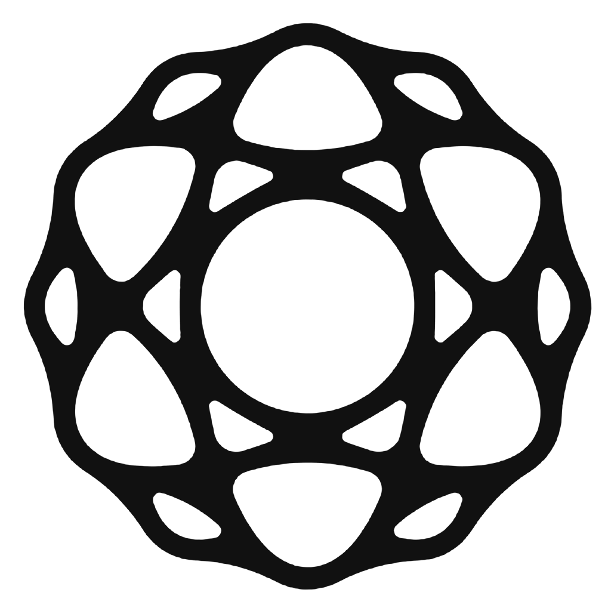

<p align="center">
  <picture>
    <source media="(prefers-color-scheme: dark)" srcset="_src/ui-preview/map/brand/logo-white.png">
    
  </picture>
</p>

<h1 align="center">MYXOBRAIN//TERM</h1>

<p align="center"><b>Six minds. One market. Real data.</b></p>

<p align="center">
  <a href="https://x.com/myxobrainrh"></a>
  <a href="https://myxobrain.com/"></a>
  <a href="https://www.npmjs.com/package/myxobrain-agent"></a>
  <a href="https://github.com/myxobrain/myxobrain-agent"></a>
  <a href="LICENSE"></a>
</p>

Six minds modeled on real organisms trade the same eleven Robinhood Chain assets under the same pre-registered rules, and every number can be recomputed.

| Organism | Mechanism | Source |
|---|---|---|
| Physarum (slime mold) | tubes that carry flow thicken, idle tubes wither | Tero, Kobayashi & Nakagaki 2007 |
| Worm (*C. elegans*) | smell runs through the real 302-neuron wiring diagram to a turn or a run | Cook et al. 2019 connectome |
| Fry (zebrafish larva) | 11 spiking cells with Hebbian synapses: a cell that fires hard enough buys | leaky integrate-and-fire model |
| Ant colony | profitable trails get pheromone, unused trails evaporate | Dorigo & Gambardella 1997; Stützle & Hoos 2000 |
| Bee swarm | scouts dance for sites, the swarm moves at a quorum | Seeley & Buhrman 1999; Passino & Seeley 2006 |
| E. coli | run and tumble: keep swimming while food improves | Berg & Brown 1972 |

The home page is a terminal. In the middle, the worm's 302 real neurons turn on a ring and fire along their strongest synapses; click any organism and the same 302 particles morph into that organism's state per asset at the selected hour (tube conductivity, firing rate, pheromone, scouts, cells), with the assets it holds glowing amber.

## In your terminal

```sh
npx myxobrain-agent          # every experiment and the live test at a glance
npx myxobrain-agent league 4 # the league for EXP-004
npx myxobrain-agent verify   # re-hash the published engine and raw data
```

See [myxobrain-agent](https://github.com/myxobrain/myxobrain-agent).

## Rules (same for every organism)

- Walk-forward over four folds; each organism is born fresh at the start of a fold.
- 48 settings per organism, chosen only on data before each fold (best training Sharpe).
- 0.3% cost on every unit traded; five seeds on test, returns averaged; a blind twin with no food as a control.
- Gates, all four required: beats equal-weight hold on return, on Sharpe, drawdown no worse, wins at least 3 of 4 folds.
- The last three months are sealed and opened only for an experiment that passes every gate. None has.
- Hypotheses are written to `data/lab/ledger.json` before each run.

## Reproduce

Needs Node.js 20 or newer. There are no dependencies to install.

```sh
node server/league/verify-all.mjs            # recompute every published result and compare, fold by fold
DRY=1 node server/league/run.mjs EXP-004     # rerun a whole experiment, setting selection included -> data/league/dry/
sh deploy/build.sh                           # build the site into deploy/dist
```

The exact input files are in `data/`: `hist-1h.json` (hourly prices), `flow-1h.json` (Robinhood Chain swaps),
`news-1d.json` (GDELT tone), `league/worm-table.json` (the 302-neuron brain's answers), `league/connectome.json` (the wiring).

## Layout

- `server/lab/core.mjs`: data, costs, folds, gates, the trading loop (runs in node and in the browser)
- `server/league/orgs.mjs`: the six organisms · `foods.mjs`: the experiments · `evaluate.mjs`: one run · `verify.mjs`: the recompute check
- `server/live/`: the LIVE-001 forward test (`register.mjs` locked it, `forward.mjs` runs hourly)
- `_src/ui-preview/map/`: the site (`index.html` + `term.js` home, `ring.js` the 3D specimen, `term.css` the terminal skin)
- `deploy/build.sh`: builds it with the engine and raw data inside; `.github/workflows/pages.yml` publishes it on every push to `main`

## Not proven here

Backtests and the forward test use paper money. Prices are the underlying assets' hourly closes from Yahoo Finance.
EXP-002 has only about five weeks of on-chain data. Registration times before the on-chain anchor are self-reported.
The engine and data are the same as the NEURA league's; the live test page fills in once `server/live/forward.mjs` publishes `live/live.json` to the site.

## Data and credits

Prices: Yahoo Finance. News tone: the GDELT Project. On-chain swaps: Robinhood Chain public RPC.
Connectome: Cook et al. 2019 via OpenWorm. The 3D ring follows the WORMBRAIN layout. Each source keeps its own terms; the code is MIT licensed.
